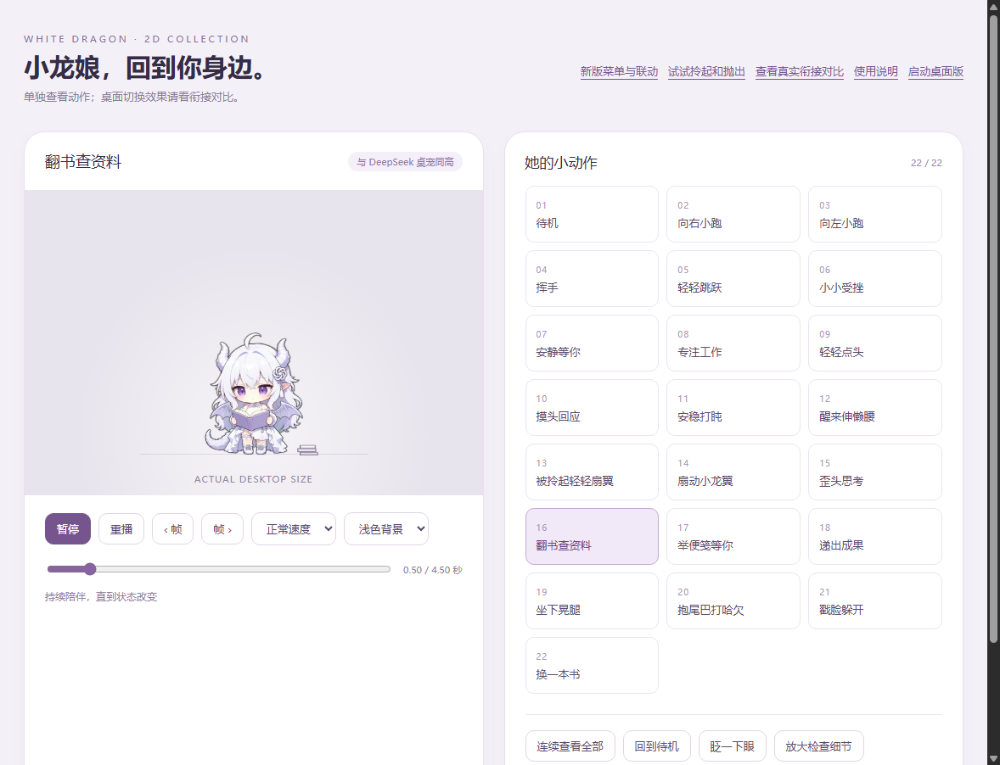

# 小龙娘 · Windows 桌宠

当前 **v10.9**：透明二维白龙娘，22个公开动作、随机眨眼、鼠标拎起、惯性抛掷与扇翼缓降，以及 ChatGPT / Codex 状态动作。

**[下载 Windows 运行包](https://github.com/linllllll1226-eng/xiaolongniang-desktop-pet/releases/latest)** · [来源与致谢](CREDITS.md) · [第三方组件与许可说明](THIRD_PARTY_NOTICES.md)



工作时持续翻页，脚边放几本书，约随机2～5分钟放下旧书并拿起另一本，直接继续阅读。思考时保持姿势，轻微呼吸歪头，圈圈持续转动。两种循环都没有夹回空手待机。提问优先于自动换书，互动结束后能恢复助手当前动作。

修正流式缓存的淘汰顺序：保留即将播放的帧，回收已播放的帧，避免预读帧被反复淘汰和解码。切换时新动作持续播放，轮廓跟随当前帧，过渡结束不倒回第一帧；强制打断保留几何对齐并减少叠影。

## 运行

解压运行包，双击 `启动小龙娘.exe`。`打开预览.html` 可离线查看、慢放和逐帧检查。轻点脸颊躲开，单击身体跳跃，双击挥手，长按头部摸头；拖拽拎起，甩出后有惯性并扇翼缓降。右键选择日常动作和联动开关。

Windows x64、.NET Framework 4.x / WPF。默认350逻辑像素画布宽，站立角色约145逻辑像素高；媒体画布640×360。60次/秒素材采样不代表原生120帧或显示器实测帧率。

## 源码构建

维护入口为 `src/runtime`、`tools/build.ps1`、`tools/Test-Current.ps1` 和 `tools/qa`。构建不依赖Python、即梦账号或旧版本缓存。媒体不存进Git；先从完整v10.9运行包导入55份内嵌资源、图标和预览文件：

```powershell
.\tools\Import-ReleaseAssets.ps1 -Executable 'C:\下载目录\小龙娘\启动小龙娘.exe'
.\tools\build.ps1
```

输出 `outputs/小龙娘_v10.9_源码构建版`，默认编译后运行隔离的原生检查。仅编译可加 `-SkipNativeTest`。导入不会复制设置或登录资料，不覆盖校验值不同的现有素材。请使用对应版本运行包。

```powershell
.\tools\Test-Current.ps1 -Target 'outputs\小龙娘_v10.9_源码构建版\启动小龙娘.exe'
.\tools\Test-Bridge.ps1 -Executable 'outputs\小龙娘_v10.9_源码构建版\白龙娘状态桥.exe'
```

八组检查涵盖113段播放切换、菜单和鼠标路由、四态映射、思考圈、24种中途过渡、6种动态目标过渡、随机眨眼、惯性缓降、持续阅读及换书计时。长时间计时和事件输入分别标明模拟范围。旧程序内 `--self-test` 属历史入口，本版使用独立检查器。

## 联动范围

本版没有验证云端调度会话的 Codex 原生生命周期回调；状态桥事件测试不代表当前聊天已接入原生 Hooks。联动开关和本机状态桥的用法见运行包内的 `联动说明.html`。

客户端观察器订阅Windows UIAutomation结构及控件状态变化，并保留低频查询。本机实测收到了真实控件事件，观察到工作与思考切换；它依据当前客户端明确控件，不读取聊天正文。普通文字提问、未暴露思考控件的版本、取消生成及后台多聊天仍有识别边界。

## 验证范围

- 换书末尾六帧与连续阅读末尾六帧完全一致，直接接阅读开头，不混入静态图片。
- 可见WPF阅读对比中，缓存修正前9秒有40次补帧等待，修正后同一计时设置9秒为0次；额外两轮也为0次。这是本机提交和解码证据，不保证其他机器或显示器恒定60/120 Hz。
- AI源片的手、衣纹和书本细线仍可能轻微变化；大姿势强制切换仍可能短暂变软、变形或重影。
- 旧衔接对比页沿用v10.4/v10.5对照，请在主预览查看新动作。

## 来源与致谢

**龙娘三视图来自 B 站 UP 主「这个刀子真甜」**，出处信息由项目维护者提供。其[相关龙娘视频](https://www.bilibili.com/video/BV1EvKK6NEoi/)简介另注明女仆和龙女形象来源于 **ZipZipPipe**，这里一并致谢；该视频是作者身份及上游署名的参考，尚未定位到本项目三视图的原始发布页。

桌宠效果与素材流程参考了 [PC2005-cloud/dsh-pet](https://github.com/PC2005-cloud/dsh-pet)，早期原型参考了 [yshuang722-spec/xiaoxiao-zhuochong](https://github.com/yshuang722-spec/xiaoxiao-zhuochong)。角色主图使用 OpenAI 图像生成工具辅助整理，动作视频使用即梦 / Seedance 生成，后续透明处理、补帧与接续使用 OpenCV、NumPy、Pillow 和 FFmpeg。完整用途、依赖范围及来源边界见 [CREDITS.md](CREDITS.md)。

## 发布与权利说明

本仓库包含当前维护的运行时源码、构建脚本和检查工具。较大的独立运行包位于 GitHub Releases；三视图原图、原始生成视频、旧版历史、设置、账号资料和私有检查日志保留在本机。

本项目代码尚未选定开源许可证，公开源码不代表另行授予使用许可。角色参考图及衍生媒体的权利归相应权利人，当前未记录可对外授予的再分发或商用许可；署名不代替授权，也不将它们统一套用为 MIT 素材。详见 [THIRD_PARTY_NOTICES.md](THIRD_PARTY_NOTICES.md)。
