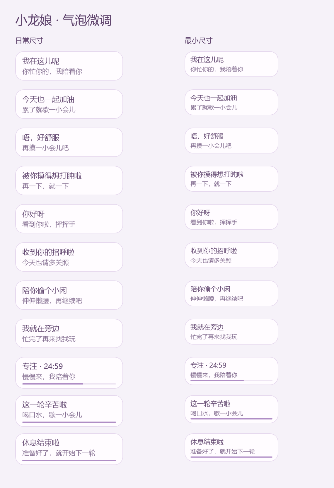

# 小龙娘 · Windows 桌宠

当前 **v10.15.2 空闲联动修正版**。透明二维白龙娘，25 个公开动作，支持鼠标互动、窗边陪伴、自主小日常、专注计时、轻语气泡，以及配置指定聊天的本机会话状态联动。

**[下载 v10.15.2](https://github.com/linllllll1226-eng/xiaolongniang-desktop-pet/releases/tag/v10.15.2)** · [来源与致谢](CREDITS.md) · [第三方与权利说明](THIRD_PARTY_NOTICES.md)

v10.15 已合并拿放书、书堆与色彩修正、光流和收势播放优化，以及“拿起一次 → 持续点按 → 放下”的平板动作。v10.15.1 进一步调整气泡文字、字号、留白和对比度，动作资源与联动逻辑沿用合并版。

v10.15.2 修复空闲时残留点平板：合并版不再读取全局旧 Hooks 状态，启动时恢复已结束聊天为空闲，结束提示后维持空闲信号。详情见 [修复说明](docs/release-10.15.2.md)。

## 运行

下载 `xiaolongniang-v10.15.2-windows-x64.zip`，解压后双击 `启动小龙娘.exe`。Windows x64，使用系统 .NET Framework 4.x / WPF。运行目录需要可写，以保存本机设置。

轻点脸颊躲开，单击身体跳跃，双击挥手，长按头部摸头；拖拽拎起，甩出后惯性滑行并扇翼缓降。连续点击可触发鼓脸护头与回弹。右键选择动作、窗边陪伴、轻语或专注计时。

`打开预览.html` 可离线查看平板三段和气泡样式；它展示素材与界面，桌面切换与交互以实际程序为准。

## 连接本项目聊天

普通桌宠可独立运行。需要联动时，在解压目录运行以下命令，填写你自己的项目目录；可省略 SessionPath 自动选择本项目最近活动的主聊天：

```powershell
.\tools\Configure-Session.ps1 -ProjectPath 'C:\你的项目' -SessionPath 'C:\你的用户目录\.codex\sessions\日期目录\rollout-会话文件.jsonl'
```

然后双击 `会话联动/启动当前会话联动.exe`。配置只保存在本机；发布包不预选维护者的聊天。选择的会话文件必须位于当前用户的 `.codex/sessions`，且其元数据必须对应所选项目。默认跟随所选项目最近活动的主聊天，检查最近七天的会话；不聚合多个任务。使用 `-FixedSession` 可固定会话，切换项目需重新配置。

启动时恢复末尾最多 8 MiB 的会话状态，之后读取新追加的生命周期和工具记录，输出枚举状态、时间及散列标识；不保存聊天正文、命令或工具结果，也不执行记录内容。命令期间持续点平板，查资料时阅读，回复结束提示一次；回复结束不代表任务成功。该本地记录格式可能随 Codex 更新而变化；此路径与原生命令 Hooks 分别记录，不能据此声称原生 Hooks 已接通。

## 源码构建

本仓库提供维护源码和检查工具。较大的媒体位于 Release 的程序内，构建前从对应运行包导入 65 份资源：

```powershell
.\tools\Import-ReleaseAssets.ps1 -Executable 'C:\解压目录\启动小龙娘.exe'
.\tools\build.ps1 -Unified -SkipNativeTest
```

输出 `outputs/小龙娘_v10.15.2_空闲联动修正版`。构建会编译同版本状态桥和与新程序 SHA-256 绑定的会话适配入口；从干净源码构建无需 Python、生成服务账号或旧媒体缓存。构建时生成的会话配置只用于本机，不能提交到 Git。

```powershell
.\tools\Test-Current.ps1
.\tools\Test-Unified.ps1 -SkipCore -Suites TabletLogic,RelayLogic,BridgeLease,TabletNative,Focus,SmallTalk
```

更多专项检查可通过 `-Suites` 选择。需要父版本对照的检查，还需提供 `-BookBaseline` 和 `-TabletBaseline` 对应的历史程序；不能用合并版替代父版来伪造比较结果。当前发布验证见 [publish-verification.json](docs/publish-verification.json)。

## 版本与已知边界

- [v10.15 全量合并说明](docs/release-10.15.md)、[v10.15.2 气泡微调说明](docs/release-10.15.1.md)。父版验收和当前程序的验收分别标明。
- AI 视频的视线、指尖接触、衣纹与书本细线仍有变化；没有声称这些细节全部经过用户验收。
- 原素材约 24 fps，60 Hz 重采样不代表原生 60 fps 或显示器稳定 60 fps。历史高负载停顿记录保留，检查通过不保证所有机器均无停顿。
- 本次公开包不包含私人会话配置、个人设置、日志、原始三视图和生成原片。代码未选定开源许可证；角色及衍生媒体的授权状态见权利说明。

## 来源与致谢

**龙娘三视图来自 B 站 UP 主「这个刀子真甜」**，由维护者提供出处。其[相关视频](https://www.bilibili.com/video/BV1EvKK6NEoi/)另注明角色形象来源于 **ZipZipPipe**，在此一并致谢；该视频不是本项目三视图的原始发布页或授权证明。

效果和素材流程参考 [PC2005-cloud/dsh-pet](https://github.com/PC2005-cloud/dsh-pet)，早期原型参考 [yshuang722-spec/xiaoxiao-zhuochong](https://github.com/yshuang722-spec/xiaoxiao-zhuochong)。图像整理使用 OpenAI 图像生成工具，动作使用即梦 / Seedance，素材处理使用 OpenCV、NumPy、Pillow、FFmpeg。完整用途与来源边界见 [CREDITS.md](CREDITS.md)。


